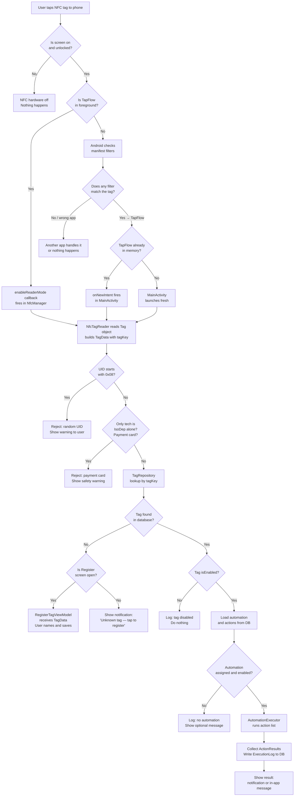

# TapFlow — Revised Engineering Plan
### Verified · Corrected · Beginner-Ready

> [!IMPORTANT]
> **This is v2 of the plan.** Three significant errors from the original were found and fixed during review. The corrections are explained in plain language at the top of each affected section so you understand what changed and why.

---

## What Changed from v1 — Plain English Summary

### Fix 1 — The NFC catch-all filter was risky ⚠️
**Original plan:** Used `ACTION_TAG_DISCOVERED` in the manifest as the "catch-all" to wake up TapFlow from the background.

**The problem:** Android's documentation explicitly warns that `ACTION_TAG_DISCOVERED` is the *lowest-priority* fallback. When multiple installed apps register for it (e.g., Samsung's built-in NFC tool, Google Pay, other tag apps), Android shows an "Open with…" chooser dialog. The user must tap the screen to pick an app — but they've already moved the phone away from the tag by then. The NFC connection is lost. This is a known, documented UX failure mode.

**Fix:** Use `ACTION_TECH_DISCOVERED` as the primary background filter (which is higher priority), paired with an `ACTION_NDEF_DISCOVERED` filter for NDEF tags. These are more specific, so Android skips the chooser and opens TapFlow directly.

---

### Fix 2 — Wrong foreground NFC API ⚠️
**Original plan:** Used `enableForegroundDispatch()` to capture tags while the app is open.

**The problem:** This is a legacy API from Android 2.3 (2011). It works by sending the tag through Android's Intent system, which routes through `onNewIntent()` — adding unnecessary complexity. The modern replacement `enableReaderMode()` (API 19 / Android 4.4) gives you a direct callback when a tag is detected, no Intent plumbing needed. It also disables phone-to-phone NFC pairing features, which prevents false triggers.

**Fix:** Use `enableReaderMode()` for the foreground case.

---

### Fix 3 — Hilt is too complex for a beginner ⚠️
**Original plan:** Used Hilt (Google's dependency injection framework) throughout.

**The problem:** Hilt requires KSP annotation processing, multiple plugin configurations, and produces confusing error messages when misconfigured. Google's own documentation says: *"For smaller apps or beginners, manual dependency injection is the recommended starting point."* Hilt is powerful, but it's a source of build failures that are hard to diagnose without Android experience.

**Fix:** Replace Hilt with a simple `AppContainer` class stored on the Application object. This is pure Kotlin — no magic, no annotations, no build plugins. The app can be migrated to Hilt later if needed.

---

## Table of Contents

1. [What the App Does — In Plain Terms](#1-what-the-app-does--in-plain-terms)
2. [What Android Actually Allows — NFC Behavior](#2-what-android-actually-allows--nfc-behavior)
3. [Architecture — How the Pieces Fit Together](#3-architecture--how-the-pieces-fit-together)
4. [File Structure](#4-file-structure)
5. [Dependencies — Exact Versions](#5-dependencies--exact-versions)
6. [Data Model](#6-data-model)
7. [Automation Actions](#7-automation-actions)
8. [NFC Event Flow](#8-nfc-event-flow)
9. [Screens and Navigation](#9-screens-and-navigation)
10. [Permissions Matrix](#10-permissions-matrix)
11. [Testing Plan](#11-testing-plan)
12. [Build Commands and Troubleshooting](#12-build-commands-and-troubleshooting)
13. [Milestones and Acceptance Criteria](#13-milestones-and-acceptance-criteria)
14. [Implementation Checklist for Gemini](#14-implementation-checklist-for-gemini)

---

## 1. What the App Does — In Plain Terms

TapFlow is a personal automation app for Android. Here's the entire user story:

1. **Register a tag:** The user opens TapFlow, goes to "Register Tag", and taps an NFC tag to their phone. TapFlow reads an identifier from the tag and the user types a name for it (e.g., "Study Mode").

2. **Build an automation:** The user creates a sequence of actions for that tag. For example: *open the Spotify app, then open a study playlist URL, then show a notification saying "Focus time!"*

3. **Trigger it:** Next time the user taps that same tag to their phone — even if TapFlow isn't open — Android wakes TapFlow up, it recognizes the tag, and runs the automation.

That's it. Everything else in this document is about how to make those three steps work reliably.

---

## 2. What Android Actually Allows — NFC Behavior

> [!NOTE]
> These are **confirmed facts** from Android's official developer documentation. Anything labelled "assumption" has not been independently verified against device hardware and may vary.

### 2.1 The Basics of How NFC Works on Android

When you tap an NFC tag, Android's NFC service wakes up and tries to figure out which app should handle it. It checks apps in priority order:

1. **Most specific first:** Does the tag contain NDEF data that matches an app's declared MIME type or URL? → `ACTION_NDEF_DISCOVERED`
2. **Tech-specific second:** Does the tag's hardware type match an app's declared technology list? → `ACTION_TECH_DISCOVERED`
3. **Catch-all last:** No match above? → `ACTION_TAG_DISCOVERED`

The catch-all (#3) is where the "which app?" chooser dialog appears if multiple apps registered for it. **We avoid relying on #3.**

### 2.2 App State vs. What Happens

This table shows the confirmed behavior for each scenario.

| Situation | What Happens | Notes |
|---|---|---|
| **TapFlow is open on screen** | Tag detected immediately via `enableReaderMode()` callback | Exclusive priority, no chooser dialog |
| **TapFlow is in the background** (process alive but not visible) | Android reads our manifest filter and brings TapFlow back to the foreground | Works because NFC is a hardware-initiated event — Android grants it a special exemption from the normal "don't wake apps from the background" rules |
| **TapFlow is completely closed** | Android launches TapFlow fresh via our manifest filter | Same special exemption applies |
| **Screen is off or locked** | **Nothing happens** | NFC hardware turns off when the screen is off. This is a hardware-level limit, not a software restriction. No workaround exists for a normal consumer app. |
| **User force-stopped TapFlow** | **Nothing happens** | Android's documentation explicitly states that force-stopped apps cannot be woken by any implicit intent, including NFC. The user must open TapFlow manually at least once to "un-stop" it. |
| **NFC is turned off in Settings** | **Nothing happens** | Show a message in the Settings screen with a link to the system NFC settings. |

> [!WARNING]
> **These two limitations are permanent and cannot be coded around.** The settings screen must explain them clearly so users aren't confused when "nothing happens" after locking their phone or force-stopping the app.

### 2.3 The Manifest Filter Strategy (Confirmed Correct)

TapFlow registers two manifest intent filters. Both are higher priority than the catch-all:

**Filter A — for tags with NDEF data** (e.g., tags you've written data to previously):
```xml
<intent-filter>
    <action android:name="android.nfc.action.NDEF_DISCOVERED" />
    <category android:name="android.intent.category.DEFAULT" />
    <data android:mimeType="application/vnd.tapflow" />
</intent-filter>
```

**Filter B — for all hardware tag types** (the broader net, catches blank tags, transport cards, hotel keys):
```xml
<intent-filter>
    <action android:name="android.nfc.action.TECH_DISCOVERED" />
    <category android:name="android.intent.category.DEFAULT" />
</intent-filter>
<!-- Paired with a tech-list XML file listing NfcA, NfcB, NfcF, NfcV -->
```

Both filters give Android enough specificity to route directly to TapFlow without showing a chooser.

> [!NOTE]
> **Assumption:** On devices with Samsung's "Smart Things" or similar pre-installed NFC apps, there may still be occasional chooser conflicts for certain tag types. If this occurs in testing, the fix is to add the foreground `enableReaderMode()` call, which overrides all other apps with absolute priority when TapFlow is open.

### 2.4 Tag Identifier — What's Reliable

Every NFC tag has a hardware ID called a UID (or PUPI for certain card types). Android exposes this via `tag.id`.

**What's stable:**
- **NFC-A tags** (most common stickers, key fobs, NTAG213/215/216): 7-byte UID, permanently written at the factory. Very reliable as an identifier.
- **NFC-F** (FeliCa, common in Japan): Stable 8-byte ID.
- **NFC-V** (ISO 15693, used in some warehouse/inventory tags): Stable 8-byte ID.

**What's NOT stable:**
- **NFC-A tags with a UID starting with `0x08`**: Per the ISO standard, this prefix means the UID is randomly generated on every scan. You cannot identify these tags reliably. TapFlow must detect and reject them.
- **NFC-B tags** (PUPI): The PUPI can be pseudo-random. Treat as unreliable unless verified.
- **Payment cards** (Visa, Mastercard, etc.): These use ISO-DEP and rotate their identifiers per session for security. TapFlow must detect and refuse these — and must never attempt to read any card data beyond the tag identifier check.

**The composite identifier used by TapFlow:**
```
tagKey = hex(tag.id) + ":" + sortedAndJoined(tag.techList)
```
Example: `"04a3bc7d22680:NfcA,NdefFormatable"` 

The tech list (sorted alphabetically and joined) acts as a secondary discriminator. In the extremely unlikely case two tags share a UID, their different tech lists will distinguish them.

---

## 3. Architecture — How the Pieces Fit Together

Think of the app as three floors of a building. Each floor only talks to the one directly below it.

```
┌─────────────────────────────────┐
│  TOP FLOOR: Screens (UI)        │  What the user sees. Jetpack Compose.
│  HomeScreen, RegisterScreen...  │  These only read from ViewModels.
└────────────┬────────────────────┘
             │ reads state, sends events
┌────────────▼────────────────────┐
│  MIDDLE FLOOR: ViewModels       │  Brain of each screen. Coordinates data.
│  HomeViewModel, TagViewModel... │  Only talks to Repositories.
└────────────┬────────────────────┘
             │ queries and saves data
┌────────────▼────────────────────┐
│  GROUND FLOOR: Data             │  Room database + NFC reading.
│  Repositories, DAOs, NfcManager │  The only things that touch the DB or hardware.
└─────────────────────────────────┘
```

**Why this structure?** Each screen's logic lives in one place (its ViewModel), which makes it easy to find and fix bugs. The database logic is isolated, so changing how data is stored doesn't break the UI.

### Dependency Injection — The Simple Way

Instead of Hilt, we use an `AppContainer` — a plain Kotlin class that creates and holds shared objects. ViewModels get their dependencies from it via `ViewModelProvider.Factory`.

```kotlin
// TapFlowApp.kt
class TapFlowApp : Application() {
    // Created once. Everything that needs shared access goes here.
    val container: AppContainer by lazy { AppContainer(this) }

    override fun onCreate() {
        super.onCreate()
        createNotificationChannel()
    }
}

// AppContainer.kt
class AppContainer(context: Context) {
    private val db = AppDatabase.create(context)

    val tagRepository = TagRepository(db.registeredTagDao())
    val automationRepository = AutomationRepository(db.automationDao(), db.actionDao())
    val executionLogRepository = ExecutionLogRepository(db.executionLogDao())
    val automationExecutor = AutomationExecutor(context)
    val nfcDispatchCoordinator = NfcDispatchCoordinator(
        tagRepository, automationRepository, automationExecutor, executionLogRepository
    )
}
```

To access the container from a ViewModel:
```kotlin
// In any Activity or Composable that needs a ViewModel:
val app = context.applicationContext as TapFlowApp
val viewModel: HomeViewModel = viewModel(factory = HomeViewModel.Factory(app.container))
```

---

## 4. File Structure

```
app/src/main/java/com/tapflow/
│
├── TapFlowApp.kt                    # Application class; holds AppContainer
├── AppContainer.kt                  # Creates and holds all shared objects
├── MainActivity.kt                  # Single Activity; NFC intent entry point
│
├── nfc/
│   ├── NfcManager.kt               # Wraps NfcAdapter; enableReaderMode setup
│   ├── NfcTagReader.kt             # Converts raw Tag → TagData
│   ├── TagIdentifier.kt            # Builds composite tagKey; detects bad tags
│   ├── NfcDispatchCoordinator.kt   # "Glue": tag found → look up DB → run automation
│   └── model/
│       └── TagData.kt              # Data class: tagKey, techList, rawId, flags
│
├── data/
│   ├── db/
│   │   ├── AppDatabase.kt
│   │   ├── entity/
│   │   │   ├── RegisteredTagEntity.kt
│   │   │   ├── AutomationEntity.kt
│   │   │   ├── ActionEntity.kt
│   │   │   └── ExecutionLogEntity.kt
│   │   └── dao/
│   │       ├── RegisteredTagDao.kt
│   │       ├── AutomationDao.kt
│   │       ├── ActionDao.kt
│   │       └── ExecutionLogDao.kt
│   └── repository/
│       ├── TagRepository.kt
│       ├── AutomationRepository.kt
│       └── ExecutionLogRepository.kt
│
├── automation/
│   ├── AutomationAction.kt          # Sealed interface: all action types
│   ├── AutomationExecutor.kt        # Runs action list; debounce; error handling
│   ├── ActionMapper.kt              # Converts DB entity ↔ AutomationAction
│   └── ActionResult.kt             # Success / Failure / Skipped sealed class
│
└── ui/
    ├── navigation/
    │   ├── Screen.kt               # All route definitions (@Serializable)
    │   └── AppNavGraph.kt          # NavHost wiring all screens together
    ├── theme/
    │   ├── Theme.kt
    │   ├── Color.kt
    │   └── Type.kt
    └── screens/
        ├── home/
        │   ├── HomeScreen.kt
        │   └── HomeViewModel.kt
        ├── tags/
        │   ├── TagListScreen.kt
        │   ├── TagListViewModel.kt
        │   ├── TagDetailScreen.kt
        │   └── TagDetailViewModel.kt
        ├── register/
        │   ├── RegisterTagScreen.kt
        │   └── RegisterTagViewModel.kt
        ├── automation/
        │   ├── AutomationBuilderScreen.kt
        │   ├── AutomationBuilderViewModel.kt
        │   ├── ActionPickerScreen.kt
        │   └── ActionConfigScreen.kt
        ├── history/
        │   ├── HistoryScreen.kt
        │   └── HistoryViewModel.kt
        └── settings/
            ├── SettingsScreen.kt
            └── SettingsViewModel.kt
```

---

## 5. Dependencies — Exact Versions

Copy this into `gradle/libs.versions.toml` exactly:

```toml
[versions]
agp = "8.7.1"
kotlin = "2.0.21"
coreKtx = "1.15.0"
lifecycleRuntimeKtx = "2.8.7"
activityCompose = "1.9.3"
composeBom = "2025.01.00"
navigationCompose = "2.8.3"
room = "2.6.1"
ksp = "2.0.21-1.0.27"
kotlinxSerializationJson = "1.7.3"
coroutines = "1.8.1"

[libraries]
# AndroidX core
androidx-core-ktx = { group = "androidx.core", name = "core-ktx", version.ref = "coreKtx" }
androidx-lifecycle-runtime-ktx = { group = "androidx.lifecycle", name = "lifecycle-runtime-ktx", version.ref = "lifecycleRuntimeKtx" }
androidx-lifecycle-viewmodel-compose = { group = "androidx.lifecycle", name = "lifecycle-viewmodel-compose", version.ref = "lifecycleRuntimeKtx" }
androidx-activity-compose = { group = "androidx.activity", name = "activity-compose", version.ref = "activityCompose" }

# Compose
androidx-compose-bom = { group = "androidx.compose", name = "compose-bom", version.ref = "composeBom" }
androidx-compose-ui = { group = "androidx.compose.ui", name = "ui" }
androidx-compose-ui-graphics = { group = "androidx.compose.ui", name = "ui-graphics" }
androidx-compose-ui-tooling-preview = { group = "androidx.compose.ui", name = "ui-tooling-preview" }
androidx-compose-material3 = { group = "androidx.compose.material3", name = "material3" }
androidx-compose-material-icons-extended = { group = "androidx.compose.material", name = "material-icons-extended" }
androidx-navigation-compose = { group = "androidx.navigation", name = "navigation-compose", version.ref = "navigationCompose" }

# Room
room-runtime = { group = "androidx.room", name = "room-runtime", version.ref = "room" }
room-ktx = { group = "androidx.room", name = "room-ktx", version.ref = "room" }
room-compiler = { group = "androidx.room", name = "room-compiler", version.ref = "room" }

# Kotlinx
kotlinx-serialization-json = { group = "org.jetbrains.kotlinx", name = "kotlinx-serialization-json", version.ref = "kotlinxSerializationJson" }
kotlinx-coroutines-android = { group = "org.jetbrains.kotlinx", name = "kotlinx-coroutines-android", version.ref = "coroutines" }

# Testing
junit = { group = "junit", name = "junit", version = "4.13.2" }
kotlinx-coroutines-test = { group = "org.jetbrains.kotlinx", name = "kotlinx-coroutines-test", version.ref = "coroutines" }
room-testing = { group = "androidx.room", name = "room-testing", version.ref = "room" }
androidx-test-ext-junit = { group = "androidx.test.ext", name = "junit", version = "1.2.1" }
compose-ui-test-junit4 = { group = "androidx.compose.ui", name = "ui-test-junit4" }
compose-ui-test-manifest = { group = "androidx.compose.ui", name = "ui-test-manifest" }

[plugins]
android-application = { id = "com.android.application", version.ref = "agp" }
kotlin-android = { id = "org.jetbrains.kotlin.android", version.ref = "kotlin" }
kotlin-compose = { id = "org.jetbrains.kotlin.plugin.compose", version.ref = "kotlin" }
kotlin-serialization = { id = "org.jetbrains.kotlin.plugin.serialization", version.ref = "kotlin" }
ksp = { id = "com.google.devtools.ksp", version.ref = "ksp" }
```

**Note:** No Hilt plugin needed. This removes 3 plugins and avoids a common source of KSP/Hilt version conflict errors.

---

## 6. Data Model

### Entities (the tables in the database)

#### `RegisteredTagEntity` — stores each NFC tag the user has registered

```kotlin
@Entity(tableName = "registered_tags")
data class RegisteredTagEntity(
    @PrimaryKey val tagKey: String,     // e.g. "04a3bc7d22680:NfcA,NdefFormatable"
    val displayName: String,            // User typed name, e.g. "Study Mode"
    val rawUidHex: String,              // Raw bytes of the tag UID, for display
    val techList: String,               // Comma-separated sorted tech list
    val automationId: Long?,            // Which automation to run (null = none assigned)
    val registeredAt: Long,             // System.currentTimeMillis()
    val isEnabled: Boolean = true       // User can disable a tag without deleting it
)
```

#### `AutomationEntity` — a named collection of actions

```kotlin
@Entity(tableName = "automations")
data class AutomationEntity(
    @PrimaryKey(autoGenerate = true) val id: Long = 0,
    val name: String,                   // e.g. "Study Mode Sequence"
    val isEnabled: Boolean = true,
    val createdAt: Long,
    val updatedAt: Long
)
```

#### `ActionEntity` — one step inside an automation

```kotlin
@Entity(tableName = "actions")
data class ActionEntity(
    @PrimaryKey(autoGenerate = true) val id: Long = 0,
    val automationId: Long,             // Which automation this belongs to
    val type: String,                   // "OPEN_APP", "OPEN_URL", "SHOW_NOTIFICATION", "SHOW_MESSAGE"
    val configJson: String,             // JSON with the action's settings
    val sortOrder: Int,                 // 0 = first, 1 = second, etc.
    val isEnabled: Boolean = true,
    val label: String = ""              // Optional user-readable label
)
```

#### `ExecutionLogEntity` — a record of every time a tag was scanned

```kotlin
@Entity(tableName = "execution_logs")
data class ExecutionLogEntity(
    @PrimaryKey(autoGenerate = true) val id: Long = 0,
    val tagKey: String,
    val tagDisplayName: String,         // Copied at scan time (preserved if tag renamed/deleted)
    val automationName: String,         // Copied at scan time
    val timestamp: Long,
    val durationMs: Long,
    val overallSuccess: Boolean,
    val actionResultsJson: String       // JSON array of per-action results
)
```

> [!NOTE]
> The log stores the tag name and automation name **as copies**, not as references. This means your history stays accurate even if you later rename or delete the tag or automation.

### DAOs (the query functions)

```kotlin
@Dao interface RegisteredTagDao {
    @Query("SELECT * FROM registered_tags ORDER BY registeredAt DESC")
    fun getAllTagsFlow(): Flow<List<RegisteredTagEntity>>

    @Query("SELECT * FROM registered_tags WHERE tagKey = :tagKey LIMIT 1")
    suspend fun findByTagKey(tagKey: String): RegisteredTagEntity?

    @Insert(onConflict = OnConflictStrategy.ABORT)
    suspend fun insert(tag: RegisteredTagEntity)

    @Update suspend fun update(tag: RegisteredTagEntity)
    @Delete suspend fun delete(tag: RegisteredTagEntity)
}

@Dao interface AutomationDao {
    @Query("SELECT * FROM automations ORDER BY updatedAt DESC")
    fun getAllFlow(): Flow<List<AutomationEntity>>

    @Query("SELECT * FROM automations WHERE id = :id LIMIT 1")
    suspend fun findById(id: Long): AutomationEntity?

    @Insert(onConflict = OnConflictStrategy.REPLACE)
    suspend fun insert(automation: AutomationEntity): Long

    @Update suspend fun update(automation: AutomationEntity)
    @Delete suspend fun delete(automation: AutomationEntity)
}

@Dao interface ActionDao {
    @Query("SELECT * FROM actions WHERE automationId = :id ORDER BY sortOrder ASC")
    fun getActionsFlow(id: Long): Flow<List<ActionEntity>>

    @Query("SELECT * FROM actions WHERE automationId = :id ORDER BY sortOrder ASC")
    suspend fun getActions(id: Long): List<ActionEntity>

    @Insert(onConflict = OnConflictStrategy.REPLACE)
    suspend fun insert(action: ActionEntity): Long

    @Update suspend fun update(action: ActionEntity)
    @Delete suspend fun delete(action: ActionEntity)

    @Query("DELETE FROM actions WHERE automationId = :id")
    suspend fun deleteAllForAutomation(id: Long)
}

@Dao interface ExecutionLogDao {
    @Query("SELECT * FROM execution_logs ORDER BY timestamp DESC LIMIT 200")
    fun getRecentLogsFlow(): Flow<List<ExecutionLogEntity>>

    @Insert suspend fun insert(log: ExecutionLogEntity)

    @Query("DELETE FROM execution_logs WHERE timestamp < :before")
    suspend fun deleteOlderThan(before: Long)
}
```

### Database

```kotlin
@Database(
    entities = [RegisteredTagEntity::class, AutomationEntity::class,
                ActionEntity::class, ExecutionLogEntity::class],
    version = 1,
    exportSchema = true   // Saves schema to /app/schemas/ for migration tracking
)
abstract class AppDatabase : RoomDatabase() {
    abstract fun registeredTagDao(): RegisteredTagDao
    abstract fun automationDao(): AutomationDao
    abstract fun actionDao(): ActionDao
    abstract fun executionLogDao(): ExecutionLogDao

    companion object {
        fun create(context: Context): AppDatabase =
            Room.databaseBuilder(context, AppDatabase::class.java, "tapflow.db")
                .build()
        // Never use .fallbackToDestructiveMigration() — it would erase user's tags
    }
}
```

---

## 7. Automation Actions

### The Action Types

```kotlin
sealed interface AutomationAction {
    val id: Long
    val automationId: Long
    val sortOrder: Int
    val isEnabled: Boolean

    fun describe(): String   // Short human-readable summary shown in the builder
    fun validate(): String?  // Returns null if valid, or an error message

    data class OpenApp(
        override val id: Long, override val automationId: Long,
        override val sortOrder: Int, override val isEnabled: Boolean,
        val packageName: String,      // e.g. "com.spotify.music"
        val appDisplayName: String    // e.g. "Spotify" — stored so display works even if app uninstalled
    ) : AutomationAction {
        override fun describe() = "Open $appDisplayName"
        override fun validate() = packageName.takeIf { it.isBlank() }?.let { "Select an app" }
    }

    data class OpenUrl(
        override val id: Long, override val automationId: Long,
        override val sortOrder: Int, override val isEnabled: Boolean,
        val url: String
    ) : AutomationAction {
        override fun describe() = "Open: $url"
        override fun validate(): String? = when {
            url.isBlank() -> "Enter a URL"
            !url.startsWith("http://") && !url.startsWith("https://") -> "URL must start with https://"
            else -> null
        }
    }

    data class ShowNotification(
        override val id: Long, override val automationId: Long,
        override val sortOrder: Int, override val isEnabled: Boolean,
        val title: String,
        val body: String
    ) : AutomationAction {
        override fun describe() = "Notify: \"$title\""
        override fun validate() = title.takeIf { it.isBlank() }?.let { "Enter a notification title" }
    }

    data class ShowMessage(
        override val id: Long, override val automationId: Long,
        override val sortOrder: Int, override val isEnabled: Boolean,
        val message: String
    ) : AutomationAction {
        override fun describe() = "Message: \"$message\""
        override fun validate() = message.takeIf { it.isBlank() }?.let { "Enter a message" }
    }
}
```

### How Actions Are Stored and Loaded

Each action's type-specific settings are stored as JSON in `ActionEntity.configJson`. A mapper converts between the database format and the sealed interface:

| Action Type | `configJson` example |
|---|---|
| `OpenApp` | `{"packageName":"com.spotify.music","appDisplayName":"Spotify"}` |
| `OpenUrl` | `{"url":"https://open.spotify.com/playlist/..."}` |
| `ShowNotification` | `{"title":"Study Mode","body":"Good luck!"}` |
| `ShowMessage` | `{"message":"Switched to Study Mode"}` |

### The Executor

```kotlin
class AutomationExecutor(private val context: Context) {

    private var lastExecutedTagKey: String = ""
    private var lastExecutedAt: Long = 0L
    private val debouncMs = 500L

    suspend fun execute(tagKey: String, actions: List<AutomationAction>): List<ActionResult> {
        // Debounce: ignore if same tag tapped within 500ms
        val now = System.currentTimeMillis()
        if (tagKey == lastExecutedTagKey && (now - lastExecutedAt) < debouncMs) {
            return listOf(ActionResult.Skipped(0, "All", "Too fast — tap again"))
        }
        lastExecutedTagKey = tagKey
        lastExecutedAt = now

        return actions.filter { it.isEnabled }.map { action ->
            runCatching { runAction(action) }
                .fold(
                    onSuccess = { ActionResult.Success(action.id, action.describe()) },
                    onFailure = { e -> ActionResult.Failure(action.id, action.describe(), e.message ?: "Unknown error") }
                )
        }
    }

    private fun runAction(action: AutomationAction) = when (action) {
        is AutomationAction.OpenApp -> {
            val intent = context.packageManager.getLaunchIntentForPackage(action.packageName)
                ?: throw Exception("${action.appDisplayName} is not installed")
            intent.addFlags(Intent.FLAG_ACTIVITY_NEW_TASK)
            context.startActivity(intent)
        }
        is AutomationAction.OpenUrl -> {
            val intent = Intent(Intent.ACTION_VIEW, Uri.parse(action.url))
                .addFlags(Intent.FLAG_ACTIVITY_NEW_TASK)
            context.startActivity(intent)
        }
        is AutomationAction.ShowNotification -> { /* NotificationManager — built in Milestone 4 */ }
        is AutomationAction.ShowMessage -> { /* SharedFlow event to UI — built in Milestone 4 */ }
    }
}
```

---

## 8. NFC Event Flow



### NFC Code in MainActivity

```kotlin
// MainActivity.kt
@AndroidEntryPoint // Remove this if not using Hilt — just a regular ComponentActivity
class MainActivity : ComponentActivity() {

    private val nfcManager by lazy {
        (application as TapFlowApp).container.nfcManager
    }

    override fun onCreate(savedInstanceState: Bundle?) {
        super.onCreate(savedInstanceState)
        handleIntent(intent)   // Handle cold-start NFC launch
        setContent { AppNavGraph() }
    }

    override fun onResume() {
        super.onResume()
        nfcManager.startReaderMode(this)   // enableReaderMode
    }

    override fun onPause() {
        super.onPause()
        nfcManager.stopReaderMode(this)    // disableReaderMode
    }

    override fun onNewIntent(intent: Intent) {
        super.onNewIntent(intent)
        setIntent(intent)
        handleIntent(intent)
    }

    private fun handleIntent(intent: Intent) {
        val isNfcIntent = intent.action in listOf(
            NfcAdapter.ACTION_TAG_DISCOVERED,
            NfcAdapter.ACTION_NDEF_DISCOVERED,
            NfcAdapter.ACTION_TECH_DISCOVERED
        )
        if (!isNfcIntent) return

        val tag: Tag? = if (Build.VERSION.SDK_INT >= 33) {
            intent.getParcelableExtra(NfcAdapter.EXTRA_TAG, Tag::class.java)
        } else {
            @Suppress("DEPRECATION")
            intent.getParcelableExtra(NfcAdapter.EXTRA_TAG)
        }
        tag?.let { nfcManager.handleTag(it) }
    }
}
```

### NfcManager (corrected to use `enableReaderMode`)

```kotlin
// NfcManager.kt
class NfcManager(
    private val context: Context,
    private val coordinator: NfcDispatchCoordinator
) : NfcAdapter.ReaderCallback {

    private val adapter: NfcAdapter? = NfcAdapter.getDefaultAdapter(context)

    val isNfcAvailable get() = adapter != null
    val isNfcEnabled get() = adapter?.isEnabled == true

    // Called by MainActivity.onResume
    fun startReaderMode(activity: Activity) {
        adapter?.enableReaderMode(
            activity,
            this,
            NfcAdapter.FLAG_READER_NFC_A or
            NfcAdapter.FLAG_READER_NFC_B or
            NfcAdapter.FLAG_READER_NFC_F or
            NfcAdapter.FLAG_READER_NFC_V or
            NfcAdapter.FLAG_READER_SKIP_NDEF_CHECK,  // We identify by UID, not content
            null
        )
    }

    // Called by MainActivity.onPause
    fun stopReaderMode(activity: Activity) {
        adapter?.disableReaderMode(activity)
    }

    // Called when NFC tag is detected (foreground mode) — runs on a background thread
    override fun onTagDiscovered(tag: Tag?) {
        tag?.let { coordinator.onTagDetected(it) }
    }

    // Called for background/cold-start tags via onNewIntent
    fun handleTag(tag: Tag) {
        coordinator.onTagDetected(tag)
    }
}
```

### AndroidManifest.xml (key NFC entries)

```xml
<manifest>
    <uses-permission android:name="android.permission.NFC" />
    <uses-permission android:name="android.permission.POST_NOTIFICATIONS" />
    <uses-permission android:name="android.permission.VIBRATE" />
    <uses-feature android:name="android.hardware.nfc" android:required="true" />

    <!-- Needed on Android 11+ to query installed apps by package name -->
    <queries>
        <intent>
            <action android:name="android.intent.action.MAIN" />
            <category android:name="android.intent.category.LAUNCHER" />
        </intent>
        <intent>
            <action android:name="android.intent.action.VIEW" />
            <data android:scheme="https" />
        </intent>
        <intent>
            <action android:name="android.intent.action.VIEW" />
            <data android:scheme="http" />
        </intent>
    </queries>

    <application
        android:name=".TapFlowApp"
        ... >

        <activity
            android:name=".MainActivity"
            android:exported="true"
            android:launchMode="singleTop">   <!-- Prevents creating duplicate Activities on NFC -->

            <!-- Standard launcher entry -->
            <intent-filter>
                <action android:name="android.intent.action.MAIN" />
                <category android:name="android.intent.category.LAUNCHER" />
            </intent-filter>

            <!-- Filter A: For tags with NDEF data (higher priority than catch-all) -->
            <intent-filter>
                <action android:name="android.nfc.action.NDEF_DISCOVERED" />
                <category android:name="android.intent.category.DEFAULT" />
                <data android:mimeType="application/vnd.tapflow" />
            </intent-filter>

            <!-- Filter B: For all hardware tag types (NfcA, NfcB, NfcF, NfcV) -->
            <intent-filter>
                <action android:name="android.nfc.action.TECH_DISCOVERED" />
                <category android:name="android.intent.category.DEFAULT" />
            </intent-filter>
            <!-- tech-list file required for TECH_DISCOVERED (see res/xml/nfc_tech_filter.xml) -->
            <meta-data
                android:name="android.nfc.action.TECH_DISCOVERED"
                android:resource="@xml/nfc_tech_filter" />

        </activity>
    </application>
</manifest>
```

```xml
<!-- res/xml/nfc_tech_filter.xml -->
<resources xmlns:xliff="urn:oasis:names:tc:xliff:document:1.2">
    <tech-list>
        <tech>android.nfc.tech.NfcA</tech>
    </tech-list>
    <tech-list>
        <tech>android.nfc.tech.NfcB</tech>
    </tech-list>
    <tech-list>
        <tech>android.nfc.tech.NfcF</tech>
    </tech-list>
    <tech-list>
        <tech>android.nfc.tech.NfcV</tech>
    </tech-list>
    <tech-list>
        <tech>android.nfc.tech.IsoDep</tech>
    </tech-list>
</resources>
```

---

## 9. Screens and Navigation

### Screen List

| # | Screen | Purpose |
|---|---|---|
| 1 | **Home** | Dashboard: tag count, last scan, quick action buttons |
| 2 | **Tag List** | All registered tags; swipe to delete with confirmation |
| 3 | **Tag Detail** | See tag info, rename it, assign/unlink automation, delete |
| 4 | **Register Tag** | Scan mode with "hold tag to phone" animation; save with name |
| 5 | **Automation Builder** | List of actions; reorder, toggle, delete; add new action button |
| 6 | **Action Picker** | Grid of 4 action type cards to choose from |
| 7 | **Action Config** | Form for configuring the selected action type |
| 8 | **History** | List of execution logs; expandable per-action results |
| 9 | **Settings** | NFC status, notification permission, troubleshooting guide |

### Route Definitions

```kotlin
// Screen.kt
@Serializable sealed interface Screen {
    @Serializable data object Home : Screen
    @Serializable data object TagList : Screen
    @Serializable data class TagDetail(val tagKey: String) : Screen
    @Serializable data object RegisterTag : Screen
    @Serializable data class AutomationBuilder(val automationId: Long) : Screen
    @Serializable data object ActionPicker : Screen
    @Serializable data class ActionConfig(val actionType: String, val actionId: Long = -1) : Screen
    @Serializable data object History : Screen
    @Serializable data object Settings : Screen
}
```

### Required Empty States

Every list screen must handle the case where there's no data yet:
- **Tag List empty:** "No tags registered yet. Tap the + button and hold an NFC tag to your phone."
- **History empty:** "No automations have run yet."
- **Automation Builder empty:** "No actions yet. Tap + to add your first action."

---

## 10. Permissions Matrix

| Permission | What It's For | How Requested | Android Version |
|---|---|---|---|
| `android.permission.NFC` | Read NFC tags | In manifest only; automatically granted | All versions |
| `android.hardware.nfc` | Prevents install on phones without NFC | In manifest as `required="true"` | All versions |
| `android.permission.POST_NOTIFICATIONS` | Show notifications | Runtime popup — ask before first notification | Android 13+ only |
| `android.permission.VIBRATE` | Haptic feedback on scan | In manifest only; automatically granted | All versions |

**No other permissions are needed for the MVP.** Post-MVP settings actions (Wi-Fi, volume) require additional permissions that are deferred.

---

## 11. Testing Plan

### JVM Unit Tests (no device needed, run fast)

| Test | What It Checks |
|---|---|
| `TagIdentifierTest` | Correct hex encoding from byte arrays; 0x08 random UID detection; payment card detection |
| `ActionValidatorTest` | Each action type's `validate()` returns correct error or null |
| `AutomationExecutorTest` | Debounce logic; one action failure doesn't stop others; results list is correct |
| `ActionMapperTest` | JSON round-trip: serialize then deserialize each action type gives back equal object |

### Instrumentation Tests (run on emulator or device)

| Test | What It Checks |
|---|---|
| `RoomDatabaseTest` | Insert/query/delete for each DAO; duplicate insert throws |
| `MigrationTest` | Room `MigrationTestHelper` verifies schema v1 is valid |
| `RegisterTagScreenTest` | Compose UI test: duplicate tag warning shows; name field works |

### Manual NFC Tests (physical device + real tags required)

```
NFC-01  App open, Registration screen visible
        → Tap tag → TagData appears → Name and save → Tag appears in list ✓

NFC-02  App open, Home screen
        → Tap registered tag → Automation runs → Log entry created ✓

NFC-03  App backgrounded
        → Tap registered tag → App comes to foreground → Automation runs ✓

NFC-04  App completely closed
        → Tap registered tag → App launches → Automation runs ✓

NFC-05  App force-stopped (Settings → Apps → TapFlow → Force Stop)
        → Tap tag → Nothing happens [EXPECTED — document in Settings screen] ✓

NFC-06  NFC disabled in device settings
        → Tap tag → Nothing happens
        → Settings screen shows "NFC is off" warning ✓

NFC-07  Screen locked
        → Lock phone → Tap tag → Nothing happens [EXPECTED] ✓

NFC-08  Rapid double-tap (same tag within 500ms)
        → Only 1 log entry created; automation runs only once ✓

NFC-09  Unregistered tag tapped (app not in Registration screen)
        → Notification appears: "Unknown tag — tap to register" ✓

NFC-10  Tag with 0x08 UID (if available)
        → Warning dialog shown; registration rejected ✓

NFC-11  Payment card tapped
        → Warning shown; registration rejected; no card data accessed ✓

NFC-12  OpenApp action; target app not installed
        → Action fails gracefully; other actions still run; error in log ✓

NFC-13  OpenUrl action; invalid URL
        → Validation error shown before saving; cannot be saved ✓
```

---

## 12. Build Commands and Troubleshooting

```bash
# Check the project compiles
./gradlew compileDebugKotlin

# Build an installable APK
./gradlew assembleDebug

# Run all JVM unit tests (fast, no device)
./gradlew test

# Run instrumented tests (device or emulator must be connected)
./gradlew connectedAndroidTest

# Install on connected device
./gradlew installDebug

# Check for code quality issues
./gradlew lint
```

### Common Problems and Fixes

| Error Message | Cause | Fix |
|---|---|---|
| `NfcAdapter is null` | Running on an emulator | Use a physical Android device; emulators don't support NFC |
| `ActivityNotFoundException` when opening an app | Missing `<queries>` block in manifest | Add the `<queries>` block from Section 8 |
| `enableReaderMode: IllegalStateException` | Called outside `onResume` | Only call in `onResume`; disable in `onPause` |
| Room `IllegalStateException: Migration needed` | Entity changed without writing a migration | Add a `Migration` object and register it in `AppDatabase.create()` |
| `POST_NOTIFICATIONS` permission denied | Not requested at runtime on Android 13+ | Request using `ActivityResultContracts.RequestPermission` before showing first notification |
| KSP error about missing symbol | Room annotation processor issue | Check that `ksp` plugin is applied; `room-compiler` uses `ksp()` not `annotationProcessor()` |

---

## 13. Milestones and Acceptance Criteria

### Milestone 1 — "It Reads NFC Tags" (~Week 1)
**Done when:** App scans any NFC tag and displays its composite `tagKey` on screen. No database, no automations.

**Must pass:**
- [ ] `./gradlew assembleDebug` succeeds with no errors
- [ ] NFC permission and `uses-feature` are in the manifest
- [ ] Tapping a tag while the app is open shows the `tagKey`
- [ ] Tapping the same tag again doesn't crash
- [ ] App doesn't crash when started on a phone with NFC disabled
- [ ] `TagIdentifierTest` unit tests pass

### Milestone 2 — "Register and List Tags" (~Week 2)
**Done when:** User can scan a tag, name it, and see it in a list. Duplicates are blocked.

**Must pass:**
- [ ] Room database creates without crashing
- [ ] Scanning a new tag in the Register screen saves it correctly
- [ ] Scanning an already-saved tag shows "This tag is already registered"
- [ ] Tag list shows all saved tags
- [ ] Tag can be renamed; new name persists after app restart
- [ ] Tag can be deleted; it disappears from the list
- [ ] Tapping a payment card shows a safety warning and does NOT save it
- [ ] DAO instrumentation tests pass

### Milestone 3 — "Automations Actually Run" (~Week 3)
**Done when:** Scanning a registered tag opens an app or URL. The action is logged.

**Must pass:**
- [ ] User can create an automation with an "Open App" action
- [ ] User can create an automation with an "Open URL" action
- [ ] Invalid URL shows validation error; cannot be saved
- [ ] Scanning a tag with an assigned automation executes it
- [ ] History screen shows a log entry with the correct timestamp
- [ ] One action failing does NOT stop subsequent actions from running
- [ ] `AutomationExecutorTest` unit tests pass
- [ ] Manual tests NFC-01 through NFC-04 pass

### Milestone 4 — "All Actions + Full Polish" (~Week 4)
**Done when:** All 4 action types work. All error states, empty states, and limitations handled.

**Must pass:**
- [ ] ShowNotification action: notification appears in system tray
- [ ] `POST_NOTIFICATIONS` permission requested before first notification on Android 13+
- [ ] ShowMessage action: visible in-app message appears
- [ ] Rapid double-tap (NFC-08) produces only one log entry
- [ ] Settings screen shows NFC on/off status
- [ ] Settings screen has a "why doesn't it work when locked?" explanation
- [ ] Settings screen has a "why doesn't it work after force-stop?" explanation
- [ ] All 13 manual NFC tests pass and are documented

### Milestone 5 — "Stable and Ready" (~Week 5)
**Done when:** All automated tests pass. Lint is clean. No known crashes.

**Must pass:**
- [ ] `./gradlew test` — zero failures
- [ ] `./gradlew connectedAndroidTest` — zero failures
- [ ] `./gradlew lint` — zero errors
- [ ] All touch targets are at least 48dp
- [ ] All icon buttons have `contentDescription` for accessibility
- [ ] No network requests made during any normal use flow (verify with Android Profiler)

---

## 14. Implementation Checklist for Gemini

This is the **exact ordered list of steps** to implement TapFlow. Each step must be completed and verified before the next begins.

```
━━━━━━━━━━━━━━━━━━━━━━━━━━━━━━━━━━━
 SETUP — Do this first
━━━━━━━━━━━━━━━━━━━━━━━━━━━━━━━━━━━

Step 01. Create a new Android project in Android Studio:
         - Application name: TapFlow
         - Package name: com.tapflow
         - Minimum SDK: API 26 (Android 8.0)
         - Language: Kotlin
         - Build config: Kotlin DSL (build.gradle.kts)
         - Template: Empty Activity (with Jetpack Compose)

Step 02. Replace the auto-generated gradle/libs.versions.toml with the
         exact content from Section 5 of this plan.

Step 03. In app/build.gradle.kts, apply these plugins:
           alias(libs.plugins.android.application)
           alias(libs.plugins.kotlin.android)
           alias(libs.plugins.kotlin.compose)
           alias(libs.plugins.kotlin.serialization)
           alias(libs.plugins.ksp)
         NO Hilt plugin. NO kapt plugin.

Step 04. In app/build.gradle.kts, add all library dependencies from
         Section 5. Use ksp() for room-compiler.
         Add to android block:
           ksp { arg("room.schemaLocation", "$projectDir/schemas") }

Step 05. Run: ./gradlew assembleDebug
         MUST succeed before proceeding. Fix any errors before moving on.

━━━━━━━━━━━━━━━━━━━━━━━━━━━━━━━━━━━
 MILESTONE 1 — NFC Reading
━━━━━━━━━━━━━━━━━━━━━━━━━━━━━━━━━━━

Step 06. Create TapFlowApp.kt:
         - Extends Application
         - Has a lazy AppContainer property (container will be built later)
         - Creates a notification channel named "tapflow_automations"

Step 07. Update AndroidManifest.xml:
         - Add android:name=".TapFlowApp" to <application>
         - Add NFC permission, POST_NOTIFICATIONS, VIBRATE
         - Add <uses-feature android:name="android.hardware.nfc" required="true">
         - Add the <queries> block (for opening other apps)
         - Set MainActivity android:exported="true" android:launchMode="singleTop"
         - Add the NDEF_DISCOVERED intent-filter with mime type "application/vnd.tapflow"
         - Add the TECH_DISCOVERED intent-filter with meta-data pointing to nfc_tech_filter.xml

Step 08. Create res/xml/nfc_tech_filter.xml with tech-lists for
         NfcA, NfcB, NfcF, NfcV, and IsoDep (see Section 8).

Step 09. Create nfc/model/TagData.kt:
         Data class with fields: tagKey (String), techList (String),
         rawUidHex (String), hasRandomUid (Boolean), isPaymentCard (Boolean)

Step 10. Create nfc/TagIdentifier.kt:
         - Takes a Tag object
         - Reads tag.id, converts to hex string
         - Checks if first byte is 0x08 → set hasRandomUid = true
         - Checks if techList contains ONLY IsoDep and nothing else → set isPaymentCard = true
         - Sorts tag.techList alphabetically and joins with comma
         - Returns TagData with tagKey = hexUid + ":" + sortedTechList

Step 11. Write unit tests for TagIdentifier in test/ directory.
         Test: known byte array → correct hex; 0x08 prefix → random UID detected;
         IsoDep-only → payment card detected; multiple techs → sorted correctly.
         Run: ./gradlew test — must pass.

Step 12. Create nfc/NfcManager.kt:
         - Implements NfcAdapter.ReaderCallback
         - Has startReaderMode(activity) and stopReaderMode(activity) methods
         - Uses all four FLAG_READER_* flags plus FLAG_READER_SKIP_NDEF_CHECK
         - Exposes a SharedFlow<TagData> that emits when a tag is detected
         - Has a handleTag(tag) method for background/cold-start intents
         - Has isNfcAvailable and isNfcEnabled properties

Step 13. Create a placeholder AppContainer.kt with just an NfcManager
         (repositories and executor come in Milestone 2-3).

Step 14. Update TapFlowApp.kt to create AppContainer.

Step 15. Update MainActivity.kt:
         - Gets nfcManager from (application as TapFlowApp).container
         - Calls nfcManager.startReaderMode(this) in onResume
         - Calls nfcManager.stopReaderMode(this) in onPause
         - Calls nfcManager.handleTag(tag) in both onCreate and onNewIntent
           for the tag extracted from the NFC intent
         - Uses the API-level-33-safe way to get the Tag parcelable

Step 16. Create a temporary HomeScreen that collects the SharedFlow
         from NfcManager and displays the last tagKey in a Text composable.

Step 17. Test on a physical device: scan a tag → tagKey text appears.
         Verify Milestone 1 acceptance criteria from Section 13.

━━━━━━━━━━━━━━━━━━━━━━━━━━━━━━━━━━━
 MILESTONE 2 — Tag Registry
━━━━━━━━━━━━━━━━━━━━━━━━━━━━━━━━━━━

Step 18. Create all four entity files in data/db/entity/.
         Use the exact field names and types from Section 6.

Step 19. Create all four DAO files in data/db/dao/.
         Use the exact query methods from Section 6.

Step 20. Create AppDatabase.kt:
         - @Database annotation with all 4 entities, version = 1, exportSchema = true
         - Companion object with create(context) using Room.databaseBuilder
         - No fallbackToDestructiveMigration

Step 21. Create data/repository/TagRepository.kt,
         AutomationRepository.kt, and ExecutionLogRepository.kt.
         Each wraps its DAO(s) and exposes Flow and suspend functions.

Step 22. Update AppContainer.kt to create the database and all repositories.

Step 23. Write DAO instrumentation tests in androidTest/:
         - Insert a tag, query it, verify fields match
         - Insert duplicate tag, verify exception is thrown
         - Delete a tag, verify it's gone
         - Insert automation + actions, verify sorted by sortOrder
         Run: ./gradlew connectedAndroidTest — must pass.

Step 24. Create ui/theme/Theme.kt, Color.kt, Type.kt with Material 3 defaults.
         Customize colors to give TapFlow a distinct identity.

Step 25. Create ui/navigation/Screen.kt with all routes from Section 9.

Step 26. Create ui/navigation/AppNavGraph.kt.
         Start with stub screens (just a Text showing the route name).
         Wire up all routes.

Step 27. Create ui/screens/register/RegisterTagScreen.kt and
         RegisterTagViewModel.kt:
         - Shows "Hold NFC tag to phone" animation/instruction
         - Collects TagData from NfcManager SharedFlow
         - If tag has random UID: shows error dialog, does NOT offer to save
         - If tag is payment card: shows safety warning, does NOT offer to save
         - If tag already registered: shows "already registered" message
         - Otherwise: shows a text field to name the tag + Save button
         - On save: calls tagRepository.insert() and navigates back

Step 28. Create ui/screens/tags/TagListScreen.kt and TagListViewModel.kt:
         - Collects getAllTagsFlow() from TagRepository
         - Shows list of tags with name and registration date
         - Each item navigates to TagDetail on tap
         - Shows empty state if no tags
         - Swipe-to-delete with confirmation dialog

Step 29. Create ui/screens/tags/TagDetailScreen.kt and TagDetailViewModel.kt:
         - Shows tag name, tagKey, tech list, registration date
         - Rename button: inline edit + save
         - Delete button with confirmation dialog
         - "Assigned automation" section (placeholder for now)

Step 30. Replace the temporary HomeScreen with the real HomeScreen:
         - Shows registered tag count
         - Shows last scan time (or "No scans yet")
         - Navigation buttons to Tag List and Register Tag

Step 31. Verify Milestone 2 acceptance criteria from Section 13.

━━━━━━━━━━━━━━━━━━━━━━━━━━━━━━━━━━━
 MILESTONE 3 — Automations Run
━━━━━━━━━━━━━━━━━━━━━━━━━━━━━━━━━━━

Step 32. Create automation/AutomationAction.kt with the sealed interface
         and all 4 action data classes from Section 7.
         Each must implement describe() and validate().

Step 33. Create automation/ActionResult.kt with Success, Failure, Skipped.

Step 34. Create automation/ActionMapper.kt:
         - Converts ActionEntity → AutomationAction by reading type and parsing configJson
         - Converts AutomationAction → ActionEntity by serializing configJson
         - Use kotlinx-serialization for JSON

Step 35. Write unit tests for ActionMapper in test/:
         - Round-trip test for each of the 4 action types
         - Validate() returns null for valid inputs
         - Validate() returns error string for invalid inputs
         Run: ./gradlew test — must pass.

Step 36. Create automation/AutomationExecutor.kt with debounce and runAction
         logic from Section 7. Handle OpenApp and OpenUrl only in this step.

Step 37. Write unit tests for AutomationExecutor:
         - Debounce: second call within 500ms returns Skipped
         - One failure doesn't stop subsequent actions
         Run: ./gradlew test — must pass.

Step 38. Create nfc/NfcDispatchCoordinator.kt:
         - Takes TagRepository, AutomationRepository, AutomationExecutor,
           ExecutionLogRepository as constructor parameters
         - Has an onTagDetected(tag: Tag) suspend function
         - Implements the full flow from the diagram in Section 8:
           read tag → check UID → check payment card → look up DB →
           check if registered → load automation → execute → log result
         - Runs on Dispatchers.IO using a coroutine scope

Step 39. Update AppContainer.kt to create AutomationExecutor and
         NfcDispatchCoordinator, and pass coordinator to NfcManager.

Step 40. Create ui/screens/automation/ActionPickerScreen.kt:
         - Shows 4 cards: Open App, Open URL, Show Notification, Show Message
         - Each card has an icon, title, and short description
         - Tapping a card navigates to ActionConfigScreen with that type

Step 41. Create ui/screens/automation/ActionConfigScreen.kt:
         - For OpenApp: shows a searchable list of installed apps
           (query PackageManager for launcher apps)
         - For OpenUrl: shows a text field with https:// hint
         - Validate on Save; show inline errors; don't save if invalid

Step 42. Create ui/screens/automation/AutomationBuilderScreen.kt and
         AutomationBuilderViewModel.kt:
         - Shows list of actions in sortOrder order
         - Each action shows describe() text, enable/disable toggle, delete button
         - Reorder via up/down arrow buttons (drag-to-reorder is post-MVP)
         - "Add Action" button navigates to ActionPickerScreen
         - "Save Automation" button persists and navigates back

Step 43. Update TagDetailScreen to show the assigned automation (if any)
         with an "Assign Automation" button that navigates to AutomationBuilderScreen,
         and an "Unlink Automation" button.

Step 44. Create ui/screens/history/HistoryScreen.kt and HistoryViewModel.kt:
         - Collects getRecentLogsFlow() from ExecutionLogRepository
         - Shows list: tag name, automation name, timestamp, success/fail icon
         - Tap to expand: shows per-action results
         - Shows empty state if no history

Step 45. Verify Milestone 3 acceptance criteria from Section 13.

━━━━━━━━━━━━━━━━━━━━━━━━━━━━━━━━━━━
 MILESTONE 4 — Full Polish
━━━━━━━━━━━━━━━━━━━━━━━━━━━━━━━━━━━

Step 46. Implement ShowNotification in AutomationExecutor:
         - Build NotificationCompat.Builder with channel "tapflow_automations"
         - Only post the notification; do NOT start an Activity from the executor
         - Check if POST_NOTIFICATIONS permission is granted before posting

Step 47. Add runtime notification permission request to the app:
         - Use ActivityResultContracts.RequestPermission
         - Request when the user first saves a ShowNotification action
         - Show explanation dialog before the system dialog
         - On Android 12 and below: permission is not needed, skip request

Step 48. Implement ShowMessage in AutomationExecutor:
         - Emit to a SharedFlow<String> in AppContainer
         - In MainActivity, collect this flow and show a Snackbar

Step 49. Add ShowNotification and ShowMessage to ActionConfigScreen:
         - ShowNotification: title field + body field
         - ShowMessage: single message field

Step 50. Add empty state composables to all list screens:
         - TagList, History, AutomationBuilder each need an empty state
         - Show helpful instructional text, not just "No data"

Step 51. Add loading states:
         - While DB is loading, show CircularProgressIndicator
         - Collect as State with initial value of empty list

Step 52. Add confirmation dialogs to all destructive actions:
         - Delete tag, delete automation, delete action, clear history

Step 53. Create the "unknown tag" notification:
         - When NfcDispatchCoordinator finds an unregistered tag and Register
           screen is not open, post a notification
         - Tapping the notification should open RegisterTagScreen
         - Use a PendingIntent with the tag's key as an extra

Step 54. Create ui/screens/settings/SettingsScreen.kt and SettingsViewModel.kt:
         - Show NFC status (enabled/disabled) with refresh ability
         - Show notification permission status with "Grant" button
         - Troubleshooting section with expandable cards:
           * "Why doesn't it work with the screen locked?" — explain screen-off limit
           * "Why doesn't it work after Force Stop?" — explain force-stop limit
           * "TapFlow isn't launching when I tap the tag" — checklist
         - Link to system NFC settings via Intent action Settings.ACTION_NFC_SETTINGS

Step 55. Run all 13 manual NFC tests and document results.
         Verify Milestone 4 acceptance criteria from Section 13.

━━━━━━━━━━━━━━━━━━━━━━━━━━━━━━━━━━━
 MILESTONE 5 — Stability
━━━━━━━━━━━━━━━━━━━━━━━━━━━━━━━━━━━

Step 56. Write any remaining unit tests to reach coverage of:
         - TagIdentifier (all edge cases)
         - ActionMapper (all 4 types, round-trip)
         - AutomationExecutor (debounce, failure isolation)
         - TagRepository (duplicate detection logic)

Step 57. Write Compose UI instrumentation tests:
         - RegisterTagScreen: mock a duplicate tag → "already registered" shows
         - AutomationBuilderScreen: add an action → it appears in the list

Step 58. Write a MigrationTest using Room's MigrationTestHelper for version 1.
         This verifies the schema is valid and establishes a baseline for future migrations.

Step 59. Run: ./gradlew test — fix all failures before proceeding.

Step 60. Run: ./gradlew connectedAndroidTest — fix all failures.

Step 61. Run: ./gradlew lint — fix all errors (suppress warnings with justification).

Step 62. Accessibility check:
         - Every Icon used as a button must have a contentDescription
         - All clickable elements must be at least 48dp in height and width
         - Text contrast must meet WCAG AA (Material 3 handles most of this automatically)

Step 63. Open Android Studio's Network Inspector and confirm zero
         network traffic is generated during a complete use flow.

━━━━━━━━━━━━━━━━━━━━━━━━━━━━━━━━━━━
 ALL DONE — Verify all 5 milestone
 acceptance criteria are satisfied.
━━━━━━━━━━━━━━━━━━━━━━━━━━━━━━━━━━━
```

---

> [!TIP]
> **For the implementing agent:** If a step produces build errors, fix them fully before moving to the next step. Do not accumulate errors. Each step should leave the project in a buildable state.

> [!CAUTION]
> **Never use `.fallbackToDestructiveMigration()`** in the database setup. This deletes the user's registered tags and automations. If you need to change the database schema, write a proper `Migration` object.
